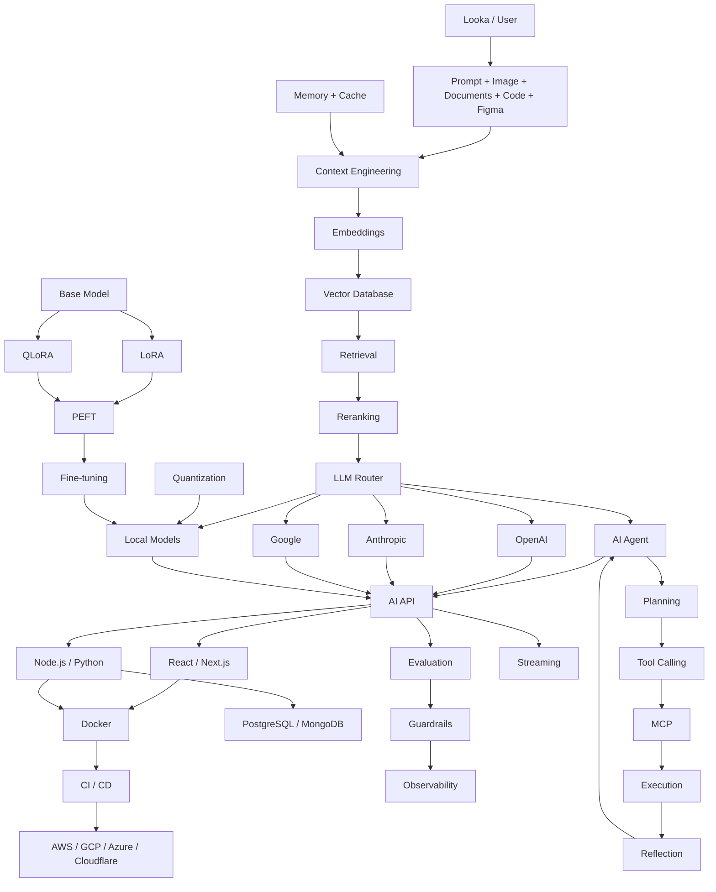

# Looka

### Frontend Engineer · Creative Developer · AI Systems Builder

Building high-performance interfaces, intelligent systems, multimodal workflows, and production-ready full-stack applications.

---

## About

I'm a frontend engineer and creative developer focused on modern digital experiences, AI-assisted development, interactive systems, and scalable application architecture.

My work sits across several highly scientific disciplines:

- Turning caffeine into questionable amounts of code
- Making websites move when they probably shouldn't
- Breaking things, then calling it debugging
- Teaching AI to do the boring parts
- Making Figma designs regret becoming real websites
- Spending 3 hours fixing a 3-pixel alignment issue
- Opening 47 browser tabs and remembering none of them
- Writing code at 3 AM and calling it productivity
- Building things that make future me say "why did I do this?"
- Occasionally remembering to commit

---

## Technology

### Languages

  

### Frontend

  

### Creative Development

  
  
  

`Three.js` · `WebGL` · `Canvas` · `GSAP` · `Anime.js` · `Lenis`

### AI & Machine Learning

  

`LLMs` · `Transformers` · `Embeddings` · `RAG` · `Agents` · `LoRA` · `QLoRA` · `PEFT` · `Fine-tuning` · `Quantization` · `Function Calling` · `Structured Output`

### Cloud & Infrastructure

  

### Tools

  

---

## AI Full-Stack Architecture

## AI Engineering

| Layer | Focus |
| --- | --- |
| LLMs | OpenAI, Anthropic, Google, open-source models |
| RAG | Embeddings, retrieval, reranking, context engineering |
| Agents | Planning, tools, memory, MCP |
| Model Engineering | LoRA, QLoRA, PEFT, fine-tuning, quantization |
| Multimodal | Text, image, documents, vision workflows |
| Evaluation | Testing, tracing, regression, quality evaluation |
| Production | APIs, streaming, queues, observability, cloud |

---

## Presence

<table>
<tr>

<td width="50%" valign="top">

### Discord

  

</td>

<td width="50%" valign="top">

### Spotify

  

</td>

</tr>
</table>

---

## GitHub Statistics

<table>
<tr>

<td width="50%" valign="top">

  

</td>

<td width="50%" valign="top">

  

</td>

</tr>
</table>

---

## Contribution Activity

  

---

## Development Interests

| Area | Technologies |
| --- | --- |
| Frontend | React, Next.js, TypeScript |
| Creative Development | Three.js, WebGL, Canvas |
| Animation | GSAP, Anime.js, Lenis |
| AI Engineering | LLMs, RAG, Agents, MCP |
| Model Engineering | LoRA, QLoRA, PEFT, Fine-tuning |
| Machine Learning | PyTorch, Transformers |
| Backend | Node.js, Python |
| Databases | PostgreSQL, MongoDB, Redis |
| Vector Search | ChromaDB, Pinecone, Weaviate |
| Cloud | AWS, GCP, Azure, Cloudflare |
| Automation | AI, APIs, n8n |
| Community | Discord Bots, Discord APIs |

---

## Connect

---

  

  Design interfaces. Engineer systems. Build intelligent systems.

